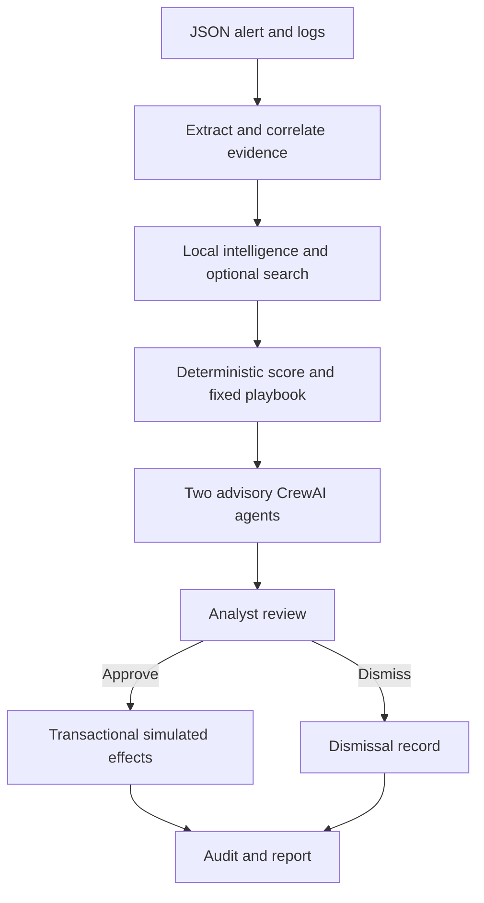

# 🛡️ AegisFlow AI

**A small, working AI-assisted SOAR hackathon project.** Investigate a phishing alert, correlate evidence, explain a fixed response plan with two CrewAI agents, obtain human approval, and record simulated containment with an incident report.

The entire application works **offline without keys**. Enable **Groq** for AI explanations, and optionally **Serper** for public-domain search context. **A Serper key does not replace a Groq key:** it is a search API, not an LLM.

> This is a local, single-analyst demonstration. Containment is explicitly simulated in SQLite. It does not access real email accounts, revoke real sessions, or modify firewalls. Synthetic intelligence is labeled as synthetic; unknown reputation is never called safe.

## What problem does it solve?

Analysts often repeat the same tasks: extract indicators, correlate alerts across users, collect evidence, choose a playbook, and document decisions. AegisFlow automates that repeatable work and uses AI to explain the findings, while keeping the execution policy and approval outside the model.

One focused demo is stronger than a large collection of loosely connected agents. The supplied phishing campaign contains three emails, a URL click, one suspicious successful sign-in, and one unrelated normal email. The application finds three affected accounts and proposes exactly five simulated actions: block one domain, quarantine three messages, and revoke the one observed suspicious session. A separate benign example proposes no actions.

## Quick start — Windows PowerShell

Install **Python 3.12**, then run:

```powershell
git clone https://github.com/Dark-AI619/Aegis-Flow-Secure-AI.git
cd Aegis-Flow-Secure-AI
py -3.12 -m venv .venv
.venv\Scripts\python.exe -m pip install -r requirements.txt
Copy-Item .env.example .env
.venv\Scripts\python.exe -m streamlit run app.py
```

Open the local address printed by Streamlit, usually `http://localhost:8501`.

## Quick start — Linux / macOS

```bash
git clone https://github.com/Dark-AI619/Aegis-Flow-Secure-AI.git
cd Aegis-Flow-Secure-AI
python3.12 -m venv .venv
.venv/bin/python -m pip install -r requirements.txt
cp .env.example .env
.venv/bin/python -m streamlit run app.py
```

Python 3.11–3.13 is supported by the declared project range; the checked workflow uses **Python 3.12**. Use a fresh virtual environment. CrewAI brings several framework dependencies even though this app does not enable embeddings or a vector database.

## Add keys

Edit your local `.env`:

```dotenv
GROQ_API_KEY=your_groq_key_here
GROQ_MODEL=llama-3.1-8b-instant
SERPER_API_KEY=your_optional_serper_key_here
AEGIS_DB_PATH=data/aegisflow.db
AEGIS_MAX_LLM_CALLS=2
AEGIS_MAX_OUTPUT_TOKENS=700
```

Get a Groq key from [Groq Console](https://console.groq.com/keys), and an optional search key from [Serper](https://serper.dev/). You can also enter keys in the sidebar, which keeps them in the current application session rather than saving them into incident records. Streamlit deployments may use `.streamlit/secrets.toml` or the hosting service's secrets editor:

```toml
GROQ_API_KEY = "your_key"
SERPER_API_KEY = "your_optional_key"
```

Never commit real keys. `.env`, Streamlit secrets, databases, generated reports, and virtual environments are ignored by Git. Only `.env.example` contains placeholders.

The sidebar offers `llama-3.1-8b-instant`, `llama-3.3-70b-versatile`, `openai/gpt-oss-20b`, and a custom model field. Check your account's [available Groq models](https://console.groq.com/docs/models) if a model is unavailable. Model access and provider quotas can change.

## Try the complete demo

1. Leave **Use Groq + CrewAI** off for the first run.
2. Choose **Phishing campaign demo** and click **Investigate incident**.
3. Inspect severity, the three affected accounts, evidence IDs, exact sources, timestamps, and hashes.
4. Open **Response & approval**. Review the five fixed actions.
5. Enter your analyst name and a decision note. Check the approval box and click **Approve simulated containment**.
6. Read the audit timeline and download the JSON or Markdown report. The case is now `contained`; a repeated execution is blocked.
7. Choose **Benign email demo** and investigate again. It should show low risk and no containment plan. Dismiss it after reviewing.
8. To demonstrate the AI layer, enter a Groq key and enable **Use Groq + CrewAI** before investigating. Offline and AI runs have separate cached incident identities.

Public search is optional and explicitly enabled by the sidebar toggle. It sends at most **two public hostnames**, not whole emails or account names, to Serper. Reserved `.test` / `.example` domains and IP addresses are skipped. The synthetic demo therefore needs no search calls. Search snippets are unverified context and **cannot raise the score or authorize containment**.

## Architecture



| Component | Responsibility | External calls |
|---|---|---|
| `tools/indicators.py` | Normalize hosts; extract sender and URL indicators | None |
| `detection.py` | Exact-host correlation, evidence metadata, heuristic score | None |
| `tools/enrichment.py` | Labeled local fixture lookup and optional Serper search | Up to 2 searches |
| `playbooks.py` + `config/playbooks.json` | Select allowed actions from observed evidence | None |
| `agents/triage_agent.py` | Explain evidence and uncertainty | Normally 1 Groq call |
| `agents/response_agent.py` | Explain the fixed plan and analyst checks | Normally 1 Groq call |
| `crew.py` | Sequential CrewAI tasks | Shares one bounded adapter |
| `storage.py` | Cache cases, validate analyst decisions, record effects atomically | None |
| `reporting.py` | Export incident, evidence, usage, timeline, effects | None |
| `app.py` | Streamlit SOC dashboard and explicit approval | None outside investigation |

See [the working concept](docs/CONCEPT.md), [demo script](docs/DEMO.md), and [team task division](docs/TEAM.md).

## Why only two agents?

The triage agent explains evidence; the response agent explains an already selected playbook. A manager agent, web-browsing loops, embeddings, and autonomous remediation would add complexity and spend without improving this focused demo. The agents have **no tools, delegation, code execution, memory, planning, or automatic retries**. Python does extraction, correlation, policy selection, storage, and execution.

The Groq adapter uses the **Groq SDK directly through CrewAI's `BaseLLM`**. It whitelists only `role` and text `content` in outgoing messages, avoiding unsupported fields such as `cache_breakpoint`. JSON output is validated locally, without an extra model call to repair it. Provider failures or invalid output produce a labeled **offline fallback**, never silent fake AI output.

The two agents share a hard default budget of **two attempted Groq requests per incident**, with at most **700 completion tokens each**. This is a call/output ceiling, not a promise about provider billing or input-token quotas. Retries attempted by the framework are blocked by the same shared counter. Cached incidents make no new provider calls. If an AI attempt fails, it is cached as a fallback for that input/mode/model; change the model or input for a deliberate fresh run.

## Folder structure

```text
app.py
requirements.txt
requirements-dev.txt
pyproject.toml
.env.example
aegisflow/
  agents/              # Separate triage_agent.py and response_agent.py
  tools/               # Indicator extraction and enrichment
  crew.py              # Actual CrewAI tasks
  llm.py               # Direct, bounded Groq SDK adapter
  models.py            # Strict Pydantic JSON contracts
  detection.py         # Heuristic and evidence correlation
  playbooks.py         # Deterministic action selection
  storage.py           # SQLite decisions, effects, and timeline
  service.py           # Shared investigation entry point
  reporting.py         # JSON and Markdown exports
  __main__.py          # CLI
config/                 # Agent and playbook JSON
schemas/                # Generated JSON schemas
samples/                # Synthetic phishing, benign, and intelligence JSON
scripts/                # Schema regeneration
docs/                   # Concept, demo, team tasks
tests/                 # Core, SDK/CrewAI, and dashboard tests
.github/workflows/      # CI
Dockerfile
```

## Upload your own JSON

Use **Upload JSON** or **Paste JSON** in the dashboard. Start from `samples/phishing_incident.json` and validate against `schemas/incident.schema.json`.

- Bundle fields: `schema_version`, `title`, `alert_event_id`, `events`.
- Events: unique `id`, `kind` (`email`, `url_click`, `signin`), timezone-aware `timestamp`, `source`, `account`, and the documented optional fields.
- The alert ID must exist in the events. A successful sign-in requires a session ID.
- Input is limited to 100 events and 2 MB; unknown fields are rejected.
- Retain source attribution. Demo `suspicious` flags are supplied observations, not an independently trained anomaly detector.

No suspicious URL is fetched or opened. Uploads are normalized evidence records, not raw `.eml` files or an arbitrary live SIEM integration. AI mode sends bounded normalized evidence—including account identifiers where present—to Groq, so use synthetic or authorized, appropriately redacted logs. Serper only receives public hostnames.

## CLI

```bash
# Offline investigation and reports (no execution)
python -m aegisflow samples/phishing_incident.json

# Two AI agents, optionally search
python -m aegisflow samples/phishing_incident.json --ai
python -m aegisflow samples/phishing_incident.json --ai --search

# Explicitly authorize the listed SIMULATED actions
python -m aegisflow samples/phishing_incident.json --approve \
  --analyst "Hannan" --note "Reviewed every synthetic target"
```

Reports appear in `reports/`; incidents and effects persist in `data/aegisflow.db`. Set `AEGIS_DB_PATH` to a durable volume if hosting. A Streamlit rerun or process restart preserves incidents on the same disk. Ephemeral hosting disks do not provide durable persistence.

## Tests

```bash
python -m pip install -r requirements-dev.txt
ruff check .
python -m pytest -q
```

Tests cover exact-target correlation, benign behavior, source metadata, invalid input, explicit approval, transaction rollback, stale plans, restart persistence, duplicate-execution prevention, cached incidents, reserved-domain filtering, Serper failures, hard API limits, unsupported Groq message fields, failure redaction, **real CrewAI orchestration with the real Groq SDK over a mocked HTTP transport**, and dashboard approval behavior. No paid keys are needed for tests. Live provider availability is not proven by mocked tests.

## Docker

```bash
docker build -t aegisflow .
docker run --rm -p 127.0.0.1:8501:8501 --env-file .env \
  -v aegisflow-data:/app/data aegisflow
```

This creates a local demo with a persistent data volume. The app does not implement login, tenant isolation, or production incident authorization. Do not treat the entered analyst name as authenticated identity.

## Limitations and next steps

- Reputation is a **small synthetic feed**, not a real VirusTotal/URLhaus service. Serper is supplemental search, not threat intelligence validation.
- Scoring is a transparent heuristic, not ML detection or a calibrated confidence probability. MITRE `T1566.002` is a static phishing playbook label, not an automatic attribution.
- Correlation matches exact hosts from the selected alert. It does not cluster campaigns across registrable domains, enforce time windows, resolve short links, or detect lookalike domains.
- AI guidance remains untrusted advisory text. The model cannot edit executable actions or bypass the approval transaction.
- Audit hashes establish traceability, but the local database is not encrypted, append-only, or tamper-proof. Raw input is not retained; hashes and normalized evidence are retained. Keys are excluded from reports.
- The app is one local demo workspace with no authentication. Concurrent investigation clicks can spend duplicate AI requests before the cache is saved; decisions and simulation effects are serialized transactionally.
- A real SOAR deployment would need authenticated roles, durable protected storage, verified live intelligence connectors, tested email/identity integrations, reversible actions, and operational playbooks.

## Hackathon scope

The only rule supplied so far is **teams of 4–6 people**. This repository supports meaningful ownership for that team size. No deadline, scoring rubric, submission format, or additional technology restrictions were provided, so compliance with those undisclosed rules is not claimed.

## Primary technical references

- [CrewAI custom LLM integration](https://docs.crewai.com/en/learn/custom-llm)
- [CrewAI agents](https://docs.crewai.com/en/concepts/agents)
- [Groq supported models](https://console.groq.com/docs/models)
- [Groq API reference](https://console.groq.com/docs/api-reference)
- [Serper search API](https://serper.dev/)
- [MITRE ATT&CK: Spearphishing Link](https://attack.mitre.org/techniques/T1566/002/)
